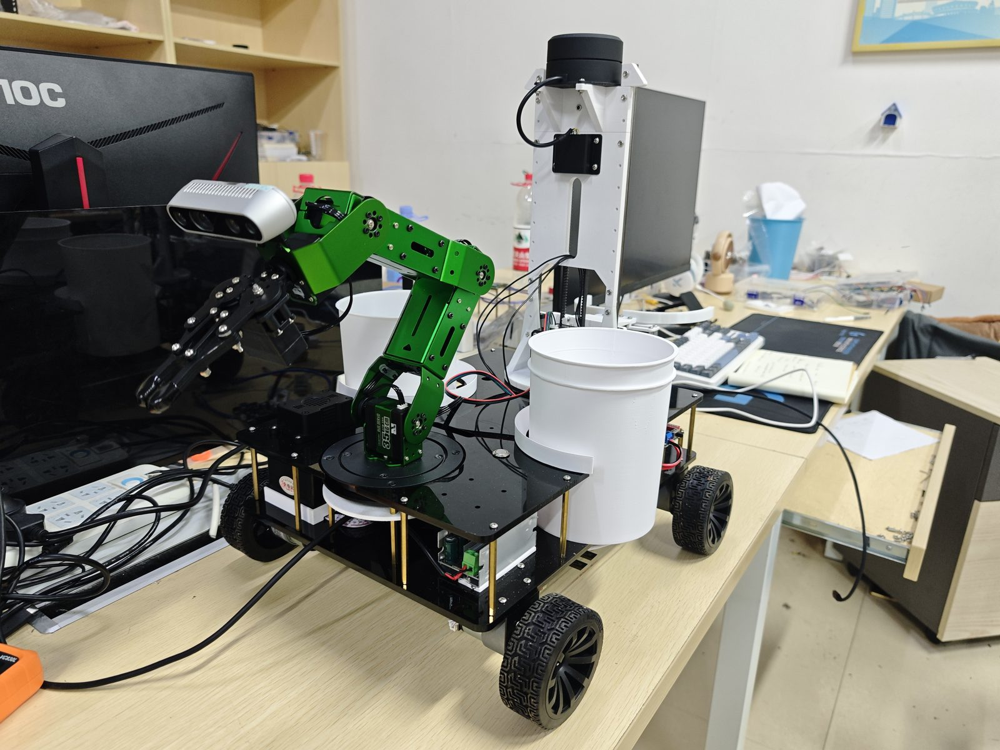
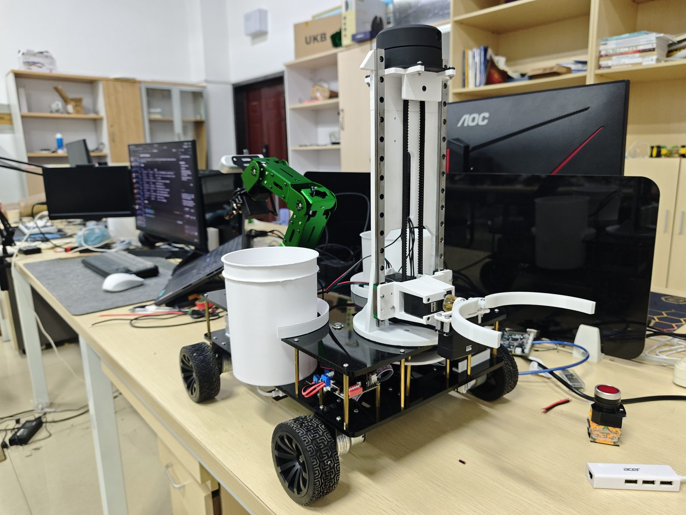

# 基于 ROS2 与嵌入式 AI 的室内自主导航垃圾拾取分类倾倒机器人

这是一个面向室内场景的自主导航垃圾拾取、分类和倾倒机器人 ROS 2 工作空间。机器人会在指定区域内自主导航和扫描垃圾，按垃圾类型使用前部机械臂夹取并投放到左右两个分类桶；区域清理完成后，机器人导航到垃圾桶位置，再通过后部升降倾倒结构把车载桶提起并倾倒到垃圾桶内。

项目包含四轮移动底盘、前部夹取机械臂、左右分类桶、后部升降倾倒机构、MoveIt、Nav2、Gazebo 仿真、硬件桥接、覆盖路径任务和传感器驱动相关包。软件既支持 Gazebo 仿真模式，也支持连接真实硬件的 custom 模式。

> 项目仍在参赛和开发阶段，硬件结构、控制策略、任务流程和配套仓库会持续更新。部分下位机固件、机械设计文件和前后端系统将在作品提交后陆续开源。

## 实机照片





## 功能演示

### MoveIt 拖动控制


### MoveIt 命令控制


### 框选区域导航


### 深度摄像头融合避障


## 真实硬件与任务流程

当前硬件形态：

- 四轮移动底盘：负责室内自主移动、区域覆盖和导航到目标点。
- 前部机械臂与夹爪：负责拾取地面或低处垃圾，并投放到指定分类桶。
- 左右两个车载垃圾桶：用于按垃圾类型暂存拾取到的垃圾。
- 后部升降倾倒结构：负责夹持、抬升、旋转并倾倒车载桶。
- 传感器：包含用于导航/建图/避障的雷达、IMU，以及用于识别或辅助抓取的相机/深度相机。
- MCU 与电机/舵机控制板：通过串口与 ROS 2 硬件桥接节点通信。

典型任务闭环：

1. 操作者在室内地图上指定清理区域。
2. Nav2 和覆盖路径节点生成区域扫描/覆盖路径。
3. 机器人沿路径巡航，结合传感器与上层识别模块发现垃圾。
4. 机械臂移动到目标位置，夹取垃圾。
5. 根据垃圾类型选择左桶或右桶投放。
6. 区域清理完成后，机器人导航到固定垃圾桶或投放点。
7. 后部升降倾倒结构夹持车载桶，抬升并倾倒垃圾。
8. 倾倒完成后复位，进入下一轮任务或待机。

## 硬件结构


去除后部升降倾倒结构后，可以看到底盘内部的电源模块、电机驱动、控制板、线束连接和机械臂底座布局。


底盘最下层安装 DK2500 上位机主控板，负责运行 ROS 2 上层程序，并通过串口与 MCU、电机驱动、舵机和步进电机控制模块通信。

## 项目结构

| 路径 | 包名 | 主要职责 |
| --- | --- | --- |
| `src/robot_description` | `robot_description` | 机器人 URDF/Xacro、底盘/轮子/机械臂/传感器模型、ros2_control 配置、Gazebo world。 |
| `src/robot_launch` | `robot_launch` | 项目总启动入口，组合 description、ros2_control、Gazebo、传感器、MoveIt、Nav2 和 RViz。 |
| `src/robot_hardware` | `robot_hardware` | C++ ros2_control 硬件接口。 |
| `src/robot_hardware_bridge` | `robot_hardware_bridge` | ROS 2 与 MCU 串口通信桥接，包含电机、机械臂、升降和倾倒控制。 |
| `src/robot_arm` | `robot_arm` | 前部机械臂 MoveIt 目标控制 Action 节点。 |
| `src/robot_manipulation` | `robot_manipulation` | 机械臂归中、左桶投放、右桶投放等高层预设动作。 |
| `src/robot_moveit_config` | `robot_moveit_config` | MoveIt 配置、规划组、控制器、RViz 和 move_group 启动文件。 |
| `src/robot_nav2` | `robot_nav2` | Nav2 参数、地图、RViz 配置和 Navigation2 启动文件。 |
| `src/robot_nav2_behaviors` | `robot_nav2_behaviors` | 指定区域选择、覆盖路径生成、覆盖任务管理和导航执行节点。 |
| `src/robot_interfaces` | `robot_interfaces` | 项目自定义 action 和 service 接口。 |
| `src/drive` | 第三方/设备驱动 | RealSense、YDLidar、IMU 等传感器驱动包。 |

## 相关仓库

本仓库主要维护 ROS 2 上层控制、导航、机械臂规划、硬件桥接和仿真配置。下位机固件、机械结构设计和前后端系统计划以独立仓库开源，链接后续补充。

| 仓库 | 内容 | 状态 |
| --- | --- | --- |
| STM32 下位机固件 | MCU 串口协议、底盘电机、机械臂舵机、升降倾倒机构步进电机和舵机控制。 | 待补充链接 |
| SolidWorks 机械设计 | 机器人底盘、机械臂安装、双桶结构、后部升降倾倒结构、装配体和零件模型。 | 待补充链接 |
| 前后端系统 | 任务配置、地图/区域选择、机器人状态监控、远程控制和可视化管理界面。 | 待补充链接 |

## 环境与依赖

需要先安装并 source ROS 2 环境：

```bash
source /opt/ros/<ros-distro>/setup.bash
```

常用依赖包括：

- ROS 2 基础工具：`colcon`、`ament_cmake`、`ament_python`
- 机器人模型与可视化：`xacro`、`robot_state_publisher`、`joint_state_publisher`、`rviz2`
- 控制与仿真：`ros2_control`、`controller_manager`、Gazebo 相关 ROS 2 包
- 规划与导航：MoveIt、Nav2
- Python 运行依赖：`numpy`、`opencv-python` 或系统对应的 `python3-numpy`、`python3-opencv`
- 设备驱动：RealSense、YDLidar、IMU 驱动及其系统依赖

可以用 rosdep 安装可解析的系统依赖：

```bash
rosdep install --from-paths src --ignore-src -r -y
```

真实硬件模式还需要按实际设备配置串口权限、设备路径和传感器连接，例如 `/dev/ttyACM0`、YDLidar 端口、RealSense USB 连接等。

## 构建

在工作空间根目录执行：

```bash
colcon build
source install/setup.bash
```

只构建某个包：

```bash
colcon build --packages-select robot_launch
source install/setup.bash
```

如果修改了接口包，建议重新构建依赖它的包：

```bash
colcon build --packages-select robot_interfaces robot_arm robot_manipulation robot_nav2_behaviors
source install/setup.bash
```

## 总启动入口

推荐使用 `robot_launch` 的总入口启动项目：

```bash
ros2 launch robot_launch robot.launch.py
```

默认参数倾向真实硬件 custom 模式：`mode:=custom`、`use_moveit:=true`、`use_rviz:=true`、`use_nav2:=false`、`use_drive:=false`。

常用示例：

```bash
# 真实硬件控制 + MoveIt + RViz，不启动真实传感器驱动
ros2 launch robot_launch robot.launch.py mode:=custom use_moveit:=true use_rviz:=true

# 真实硬件控制 + 传感器驱动
ros2 launch robot_launch robot.launch.py mode:=custom use_drive:=true use_moveit:=true use_rviz:=true

# Gazebo 仿真 + MoveIt + RViz
ros2 launch robot_launch robot.launch.py mode:=gazebo use_moveit:=true use_rviz:=true gazebo_gui:=true

# Gazebo 仿真 + Nav2 + MoveIt + RViz
ros2 launch robot_launch robot.launch.py mode:=gazebo use_nav2:=true use_moveit:=true use_rviz:=true

# 不启动 RViz，适合远程或后台运行
ros2 launch robot_launch robot.launch.py mode:=custom use_rviz:=false
```

主要 launch 参数：

| 参数 | 默认值 | 说明 |
| --- | --- | --- |
| `mode` | `custom` | 后端模式，支持 `custom` 或 `gazebo`。 |
| `use_sim_time` | `auto` | 是否使用仿真时间；`auto` 会在 Gazebo 模式使用 `true`，custom 模式使用 `false`。 |
| `use_moveit` | `true` | 启动 MoveIt `move_group` 和机械臂目标桥接。 |
| `use_nav2` | `false` | 启动 Nav2 和覆盖路径相关工具。 |
| `use_rviz` | `true` | 启动 RViz。 |
| `gazebo_gui` | `true` | Gazebo 模式下是否启动 GUI。 |
| `use_drive` | `false` | custom 模式下是否启动真实传感器和驱动。 |
| `open_loop_control` | `false` | 硬件桥接开环反馈总开关。 |
| `motor_open_loop_control` | `open_loop_control` | 电机开环反馈开关。 |
| `arm_open_loop_control` | `open_loop_control` | 机械臂开环反馈开关。 |

## 单独模块启动

仅启动 Nav2：

```bash
ros2 launch robot_nav2 navigation2.launch.py use_sim_time:=true
```

Nav2 默认地图在 `src/robot_nav2/maps/room.yaml`，也可以指定地图：

```bash
ros2 launch robot_nav2 navigation2.launch.py map:=/absolute/path/to/map.yaml
```

启动覆盖区域选择、覆盖路径生成和任务管理：

```bash
ros2 launch robot_nav2_behaviors map_rectangle_selector.launch.py use_sim_time:=true
```

启动 MoveIt move_group：

```bash
ros2 launch robot_moveit_config move_group.launch.py use_sim_time:=false
```

启动机械臂目标 Action 节点：

```bash
ros2 run robot_arm arm_moveit_target
```

启动机械臂预设姿态 Action 节点：

```bash
ros2 run robot_manipulation arm_preset_action
```

启动硬件串口桥接节点：

```bash
ros2 run robot_hardware_bridge hardware_node --ros-args \
  -p port:=/dev/ttyACM0 \
  -p baudrate:=115200 \
  -p read_rate:=100.0
```

硬件节点常用参数：

| 参数 | 默认值 | 说明 |
| --- | --- | --- |
| `port` | `/dev/ttyACM0` | MCU 串口设备路径，按实际硬件调整。 |
| `baudrate` | `115200` | 串口波特率，需要与 MCU 固件一致。 |
| `read_rate` | `100.0` | 串口读取和反馈分发频率。 |
| `debug` | `false` | 是否打印串口收发细节。 |
| `open_loop_control` | `false` | 旧版总开环反馈开关。 |
| `motor_open_loop_control` | 未设置 | 电机开环反馈；未设置时回退到 `open_loop_control`。 |
| `arm_open_loop_control` | 未设置 | 机械臂开环反馈；未设置时回退到 `open_loop_control`。 |
| `arm_servo_send_rate` | `10.0` | 舵机指令发送频率上限。 |
| `arm_servo_duration_ms` | `100.0` | 舵机运动完成时间。 |

## 接口概览

自定义接口集中在 `src/robot_interfaces`。

Action：

| 接口 | 作用 |
| --- | --- |
| `robot_interfaces/action/ArmPreset.action` | 机械臂预设姿态，支持 `ARM_CENTER`、`LEFT_BUCKET`、`RIGHT_BUCKET`。 |
| `robot_interfaces/action/ArmTarget.action` | 机械臂末端目标，输入目标位置、末端俯仰角和夹爪旋转角，返回执行结果和关节角。 |
| `robot_interfaces/action/ExecuteCoveragePath.action` | 执行覆盖路径，目标为 `nav_msgs/Path`。 |

Service：

| 接口 | 作用 |
| --- | --- |
| `robot_interfaces/srv/AddCoverageRectangle.srv` | 添加覆盖矩形区域。 |
| `robot_interfaces/srv/GenerateCoveragePath.srv` | 根据矩形范围生成覆盖路径。 |
| `robot_interfaces/srv/SetGripper.srv` | 设置夹爪开合比例和动作时长。 |
| `robot_interfaces/srv/SetLiftSteps.srv` | 设置升降机构目标步数。 |
| `robot_interfaces/srv/SetServoAngle.srv` | 设置舵机角度和动作时长。 |

常用 action 名称：

- `/arm_moveit_target`：由 `robot_arm` 提供，接收机械臂空间目标。
- `/arm_preset`：由 `robot_manipulation` 提供，执行机械臂预设姿态。
- `execute_coverage_path`：由覆盖导航节点使用，执行覆盖路径。

常用覆盖路径 topic/service 默认名：

- `coverage_rectangle`
- `coverage_path_preview`
- `add_coverage_rectangle`
- `generate_coverage_path`
- `center_square_marker`

后部升降倾倒结构默认 service 名称：

- `set_lift_steps`：控制升降步进电机目标步数。
- `set_lift_horizontal_rotation`：控制倾倒机构水平旋转舵机角度。
- `set_lift_gripper_rotation`：控制夹持机构旋转舵机角度。
- `set_lift_gripper`：控制后部夹爪开合比例。

## 测试与检查

运行全部测试：

```bash
colcon test
colcon test-result --verbose
```

运行指定包测试：

```bash
colcon test --packages-select robot_manipulation
colcon test-result --verbose
```

常用检查命令：

```bash
# 确认包可被 ROS 2 发现
ros2 pkg list | grep robot_

# 查看 Python 可执行入口
ros2 pkg executables robot_hardware_bridge
ros2 pkg executables robot_arm
ros2 pkg executables robot_manipulation
ros2 pkg executables robot_nav2_behaviors

# 查看接口
ros2 interface show robot_interfaces/action/ArmTarget
ros2 interface show robot_interfaces/action/ArmPreset
ros2 interface show robot_interfaces/srv/GenerateCoveragePath

# 查看 launch 参数
ros2 launch robot_launch robot.launch.py --show-args
```

## 常见问题

### 找不到包或可执行文件

确认已经 source ROS 2 和当前工作空间：

```bash
source /opt/ros/<ros-distro>/setup.bash
source install/setup.bash
```

如果刚修改了接口或 `setup.py`，需要重新构建并重新 source。

### 缺少 MoveIt、Nav2 或 Gazebo 依赖

先运行 rosdep：

```bash
rosdep install --from-paths src --ignore-src -r -y
```

如果仍然缺包，按当前 ROS 2 发行版安装对应的 MoveIt、Nav2、Gazebo 和 ros2_control 包。

### RViz、Nav2 或 MoveIt 时间不同步

Gazebo 模式通常需要 `use_sim_time:=true`，真实硬件 custom 模式通常需要 `use_sim_time:=false`。总启动入口使用 `use_sim_time:=auto` 时会按 `mode` 自动选择。

### 真实硬件串口无法打开

检查设备路径和权限：

```bash
ls -l /dev/ttyACM*
groups
```

如果需要访问串口，按系统配置把当前用户加入对应设备组，例如 `dialout`，然后重新登录。串口路径、波特率和 MCU 固件协议需要按实际设备保持一致。

### Nav2 无法定位或路径不可用

确认地图文件存在，`map` frame、`base_link` frame 和 TF 链路正常。Gazebo 模式下优先使用仿真时间，并检查 `src/robot_nav2/config/nav2_params` 下的参数是否与机器人模型和地图匹配。

### MoveIt 无法规划或机械臂动作失败

确认 `move_group` 已启动，规划组名为 `plan`，并检查 ros2_control 控制器是否已经加载。若使用真实硬件，先确认硬件桥接和反馈是否正常；调试阶段可以按需要启用开环反馈参数。
