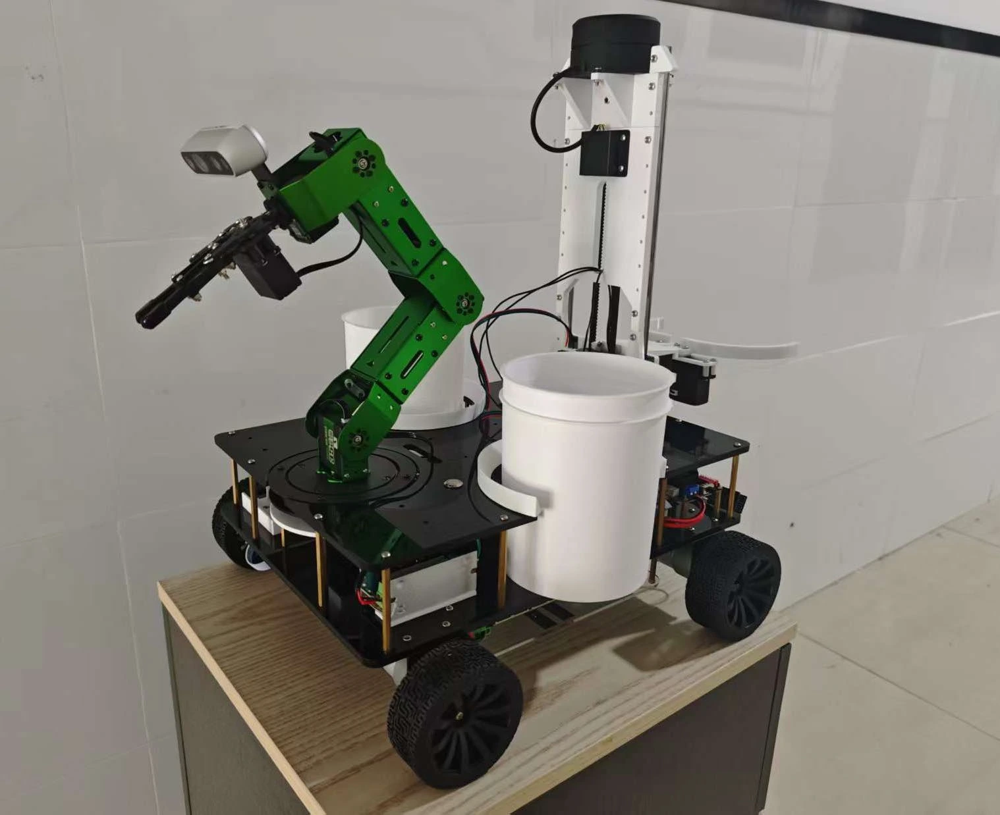
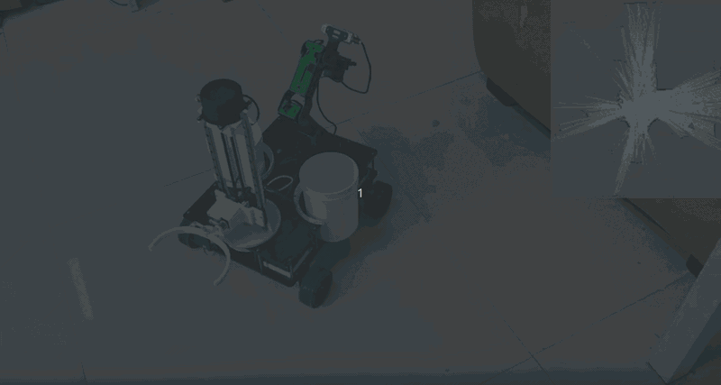
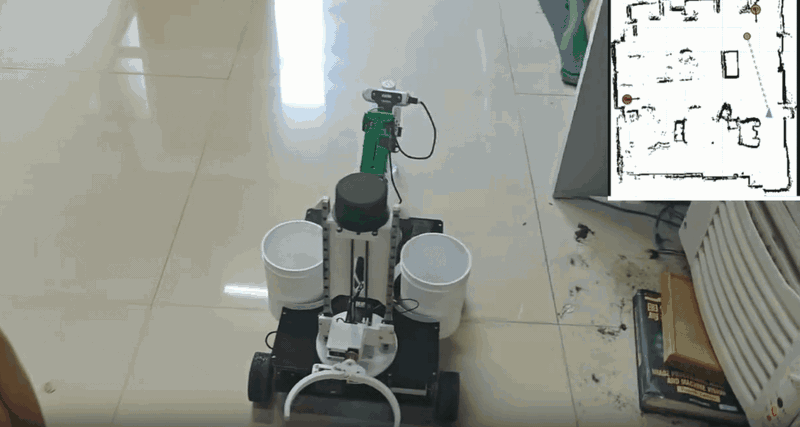
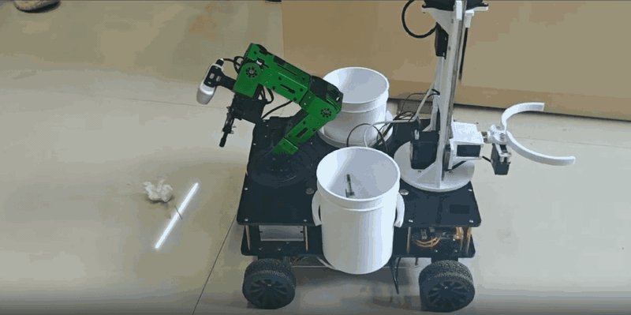
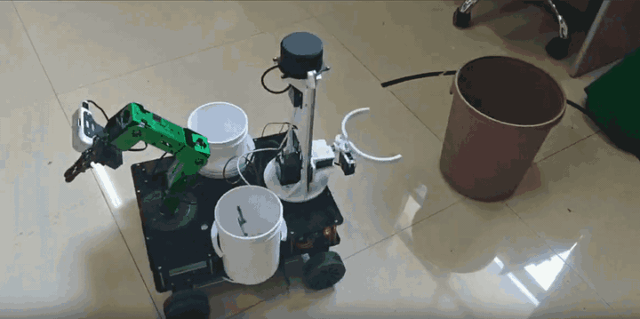
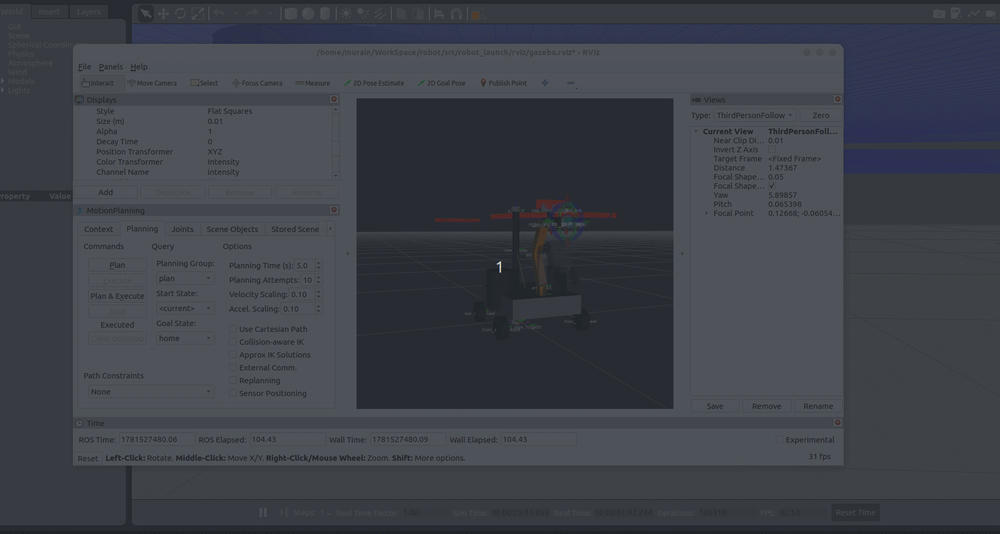
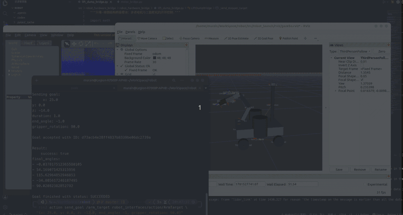
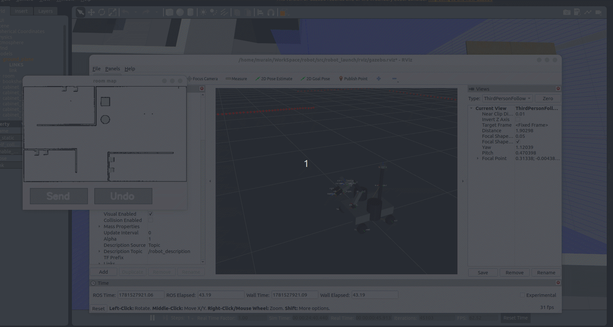
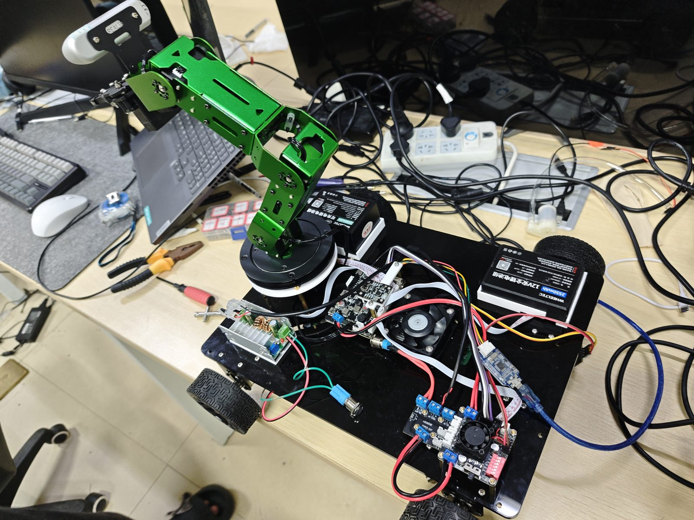
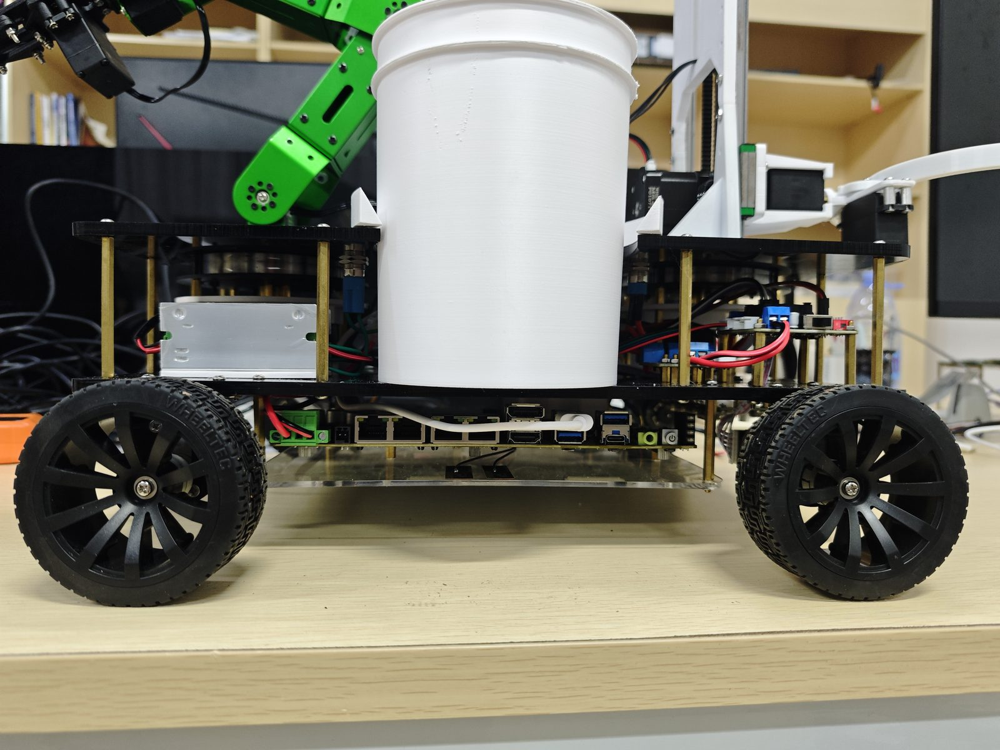

# Indoor Autonomous Trash Pickup, Sorting, and Dumping Robot Based on ROS 2 and Embedded AI

[Simplified Chinese](README.md) | [English](README_EN.md)


This is a ROS 2 workspace for an indoor autonomous robot that navigates, picks up trash, sorts it, and dumps it. The robot can navigate and scan a designated area, use the front arm to pick up trash, drop it into the left or right onboard bin according to category, and then move to a disposal point where the rear lift-and-dump mechanism empties the onboard bin.

The project includes a four-wheel mobile chassis, front pickup arm, left and right sorting bins, rear lift-and-dump mechanism, MoveIt, Nav2, Gazebo simulation, hardware bridge, coverage-path tasks, and sensor driver packages. The software supports both Gazebo simulation mode and `custom` mode for real hardware.

> This repository is maintained as an archived and showcase version of the ROS 2 host-side software and simulation configuration. The [STM32 low-level controller firmware is open source](https://gitee.com/yuzhou_888/stm32_-chassis_-controller).

## Branch Notes

- The `master` branch mainly maintains the ROS 2 host-side implementation.
- Behavior-tree related implementation is mainly maintained on the `xjw` branch.

## Recommended Environment

- Ubuntu 22.04 LTS
- ROS 2 Humble

## Quick Start

The following commands assume that ROS 2 Humble is already installed:

```bash
source /opt/ros/humble/setup.bash
rosdep install --from-paths src --ignore-src -r -y
colcon build
source install/setup.bash
ros2 launch robot_launch robot.launch.py
```

## Robot Photo



## Demos

### Real Hardware Mapping



### Real Hardware Navigation and Obstacle Avoidance



### Real Hardware Trash Pickup



### Real Hardware Trash Dumping



### MoveIt Drag Control



### MoveIt Command Control



### Area-Based Coverage Navigation



### Depth Camera Obstacle Avoidance


## Real Hardware and Workflow

Current hardware layout:

- Four-wheel mobile chassis: handles indoor autonomous movement, area coverage, and navigation to target points.
- Front arm and gripper: picks up trash from the floor or low positions and drops it into the selected sorting bin.
- Left and right onboard bins: temporarily store collected trash by category.
- Rear lift-and-dump mechanism: clamps, lifts, rotates, and dumps the onboard bin.
- Sensors: include lidar and IMU for navigation, mapping, and obstacle avoidance, plus cameras or depth cameras for recognition and pickup assistance.
- MCU and motor/servo controller boards: communicate with ROS 2 hardware bridge nodes over serial.

Typical task loop:

1. The operator selects a cleaning area on the indoor map.
2. Nav2 and coverage-path nodes generate a scanning or coverage path.
3. The robot follows the path and uses sensors plus upper-level recognition modules to find trash.
4. The arm moves to the target and picks up the trash.
5. The robot selects the left or right bin based on the trash category.
6. After the area is cleaned, the robot navigates to a fixed trash bin or disposal point.
7. The rear lift-and-dump mechanism clamps the onboard bin, lifts it, and dumps the trash.
8. The mechanism resets, and the robot enters the next task loop or standby state.

## Hardware Structure



After removing the rear lift-and-dump mechanism, the internal layout shows the power module, motor drivers, controller boards, wiring, and arm base.



The DK2500 host controller board is installed at the bottom layer of the chassis. It runs the ROS 2 host-side programs and communicates with the MCU, motor drivers, servos, and stepper motor controller modules over serial.

## Project Structure

| Path | Package | Main responsibility |
| --- | --- | --- |
| `src/robot_description` | `robot_description` | Robot URDF/Xacro, chassis/wheel/arm/sensor models, ros2_control configuration, and Gazebo world. |
| `src/robot_launch` | `robot_launch` | Main launch entry that combines description, ros2_control, Gazebo, sensors, MoveIt, Nav2, and RViz. |
| `src/robot_hardware` | `robot_hardware` | C++ ros2_control hardware interfaces. |
| `src/robot_hardware_bridge` | `robot_hardware_bridge` | ROS 2 to MCU serial bridge, including motor, arm, lift, and dump control. |
| `src/robot_arm` | `robot_arm` | Front arm MoveIt target-control Action node. |
| `src/robot_manipulation` | `robot_manipulation` | High-level preset motions such as arm center, left-bin drop, and right-bin drop. |
| `src/robot_moveit_config` | `robot_moveit_config` | MoveIt configuration, planning groups, controllers, RViz, and move_group launch files. |
| `src/robot_nav2` | `robot_nav2` | Nav2 parameters, maps, RViz configuration, and Navigation2 launch files. |
| `src/robot_nav2_behaviors` | `robot_nav2_behaviors` | Area selection, coverage-path generation, coverage task management, and navigation execution nodes. |
| `src/robot_interfaces` | `robot_interfaces` | Custom project action and service interfaces. |
| `src/drive` | Third-party/device drivers | RealSense, YDLidar, IMU, and other sensor driver packages. |

## Related Repositories

This repository mainly maintains ROS 2 host-side control, navigation, arm planning, hardware bridge, and simulation configuration. The STM32 low-level controller firmware is open source in a separate repository.

| Repository | Content | Status |
| --- | --- | --- |
| STM32 low-level controller firmware | MCU serial protocol, chassis motors, arm servos, lift-and-dump stepper motors, and servo control. | [Open source](https://gitee.com/yuzhou_888/stm32_-chassis_-controller) |

## Environment and Dependencies

Install and source a ROS 2 environment first:

```bash
source /opt/ros/<ros-distro>/setup.bash
```

Common dependencies include:

- ROS 2 base tools: `colcon`, `ament_cmake`, `ament_python`
- Robot model and visualization: `xacro`, `robot_state_publisher`, `joint_state_publisher`, `rviz2`
- Control and simulation: `ros2_control`, `controller_manager`, and Gazebo-related ROS 2 packages
- Planning and navigation: MoveIt and Nav2
- Python runtime dependencies: `numpy`, `opencv-python`, or the system packages `python3-numpy`, `python3-opencv`
- Device drivers: RealSense, YDLidar, IMU drivers, and their system dependencies

Resolvable system dependencies can be installed with rosdep:

```bash
rosdep install --from-paths src --ignore-src -r -y
```

Real-hardware mode also requires serial permissions, device paths, and sensor connections to match the actual hardware, such as `/dev/ttyACM0`, the YDLidar port, and the RealSense USB connection.

## Build

Run the following commands from the workspace root:

```bash
colcon build
source install/setup.bash
```

Build a single package:

```bash
colcon build --packages-select robot_launch
source install/setup.bash
```

If interface packages are modified, rebuild the packages that depend on them:

```bash
colcon build --packages-select robot_interfaces robot_arm robot_manipulation robot_nav2_behaviors
source install/setup.bash
```

## Main Launch Entry

The recommended entry point is the main launch file in `robot_launch`:

```bash
ros2 launch robot_launch robot.launch.py
```

Default parameters are oriented toward real-hardware `custom` mode: `mode:=custom`, `use_moveit:=true`, `use_rviz:=true`, `use_nav2:=false`, and `use_drive:=false`.

Common examples:

```bash
# Real hardware control + MoveIt + RViz, without real sensor drivers
ros2 launch robot_launch robot.launch.py mode:=custom use_moveit:=true use_rviz:=true

# Real hardware control + sensor drivers
ros2 launch robot_launch robot.launch.py mode:=custom use_drive:=true use_moveit:=true use_rviz:=true

# Gazebo simulation + MoveIt + RViz
ros2 launch robot_launch robot.launch.py mode:=gazebo use_moveit:=true use_rviz:=true gazebo_gui:=true

# Gazebo simulation + Nav2 + MoveIt + RViz
ros2 launch robot_launch robot.launch.py mode:=gazebo use_nav2:=true use_moveit:=true use_rviz:=true

# Disable RViz for remote or background execution
ros2 launch robot_launch robot.launch.py mode:=custom use_rviz:=false
```

Main launch parameters:

| Parameter | Default | Description |
| --- | --- | --- |
| `mode` | `custom` | Backend mode. Supports `custom` or `gazebo`. |
| `use_sim_time` | `auto` | Whether to use simulation time. `auto` uses `true` in Gazebo mode and `false` in custom mode. |
| `use_moveit` | `true` | Starts MoveIt `move_group` and the arm target bridge. |
| `use_nav2` | `false` | Starts Nav2 and coverage-path tools. |
| `use_rviz` | `true` | Starts RViz. |
| `gazebo_gui` | `true` | Whether to start the Gazebo GUI in Gazebo mode. |
| `use_drive` | `false` | Whether to start real sensors and drivers in custom mode. |
| `open_loop_control` | `false` | Global open-loop feedback switch for the hardware bridge. |
| `motor_open_loop_control` | `open_loop_control` | Motor open-loop feedback switch. |
| `arm_open_loop_control` | `open_loop_control` | Arm open-loop feedback switch. |

## Standalone Module Launch

Start Nav2 only:

```bash
ros2 launch robot_nav2 navigation2.launch.py use_sim_time:=true
```

The default Nav2 map is `src/robot_nav2/maps/room.yaml`. A map can also be specified explicitly:

```bash
ros2 launch robot_nav2 navigation2.launch.py map:=/absolute/path/to/map.yaml
```

Start coverage-area selection, coverage-path generation, and task management:

```bash
ros2 launch robot_nav2_behaviors map_rectangle_selector.launch.py use_sim_time:=true
```

Start MoveIt move_group:

```bash
ros2 launch robot_moveit_config move_group.launch.py use_sim_time:=false
```

Start the arm target Action node:

```bash
ros2 run robot_arm arm_moveit_target
```

Start the arm preset Action node:

```bash
ros2 run robot_manipulation arm_preset_action
```

Start the hardware serial bridge node:

```bash
ros2 run robot_hardware_bridge hardware_node --ros-args \
  -p port:=/dev/ttyACM0 \
  -p baudrate:=115200 \
  -p read_rate:=100.0
```

Common hardware node parameters:

| Parameter | Default | Description |
| --- | --- | --- |
| `port` | `/dev/ttyACM0` | MCU serial device path. Adjust according to the actual hardware. |
| `baudrate` | `115200` | Serial baud rate. Must match the MCU firmware. |
| `read_rate` | `100.0` | Serial read and feedback dispatch frequency. |
| `debug` | `false` | Whether to print serial send/receive details. |
| `open_loop_control` | `false` | Legacy global open-loop feedback switch. |
| `motor_open_loop_control` | Not set | Motor open-loop feedback. Falls back to `open_loop_control` when unset. |
| `arm_open_loop_control` | Not set | Arm open-loop feedback. Falls back to `open_loop_control` when unset. |
| `arm_servo_send_rate` | `10.0` | Maximum servo command send rate. |
| `arm_servo_duration_ms` | `100.0` | Servo movement completion time. |

## Interface Overview

Custom interfaces are located in `src/robot_interfaces`.

Actions:

| Interface | Purpose |
| --- | --- |
| `robot_interfaces/action/ArmPreset.action` | Arm preset poses, including `ARM_CENTER`, `LEFT_BUCKET`, and `RIGHT_BUCKET`. |
| `robot_interfaces/action/ArmTarget.action` | Arm end-effector target. Takes target position, end-effector pitch angle, and gripper rotation angle, then returns execution result and joint angles. |
| `robot_interfaces/action/ExecuteCoveragePath.action` | Executes a coverage path with `nav_msgs/Path` as the goal. |

Services:

| Interface | Purpose |
| --- | --- |
| `robot_interfaces/srv/AddCoverageRectangle.srv` | Adds a rectangular coverage area. |
| `robot_interfaces/srv/GenerateCoveragePath.srv` | Generates a coverage path from rectangular bounds. |
| `robot_interfaces/srv/SetGripper.srv` | Sets gripper opening ratio and motion duration. |
| `robot_interfaces/srv/SetLiftSteps.srv` | Sets target steps for the lift mechanism. |
| `robot_interfaces/srv/SetServoAngle.srv` | Sets servo angle and motion duration. |

Common action names:

- `/arm_moveit_target`: provided by `robot_arm`, receives arm spatial targets.
- `/arm_preset`: provided by `robot_manipulation`, executes preset arm poses.
- `execute_coverage_path`: used by the coverage navigation node to execute coverage paths.

Default coverage-path topic/service names:

- `coverage_rectangle`
- `coverage_path_preview`
- `add_coverage_rectangle`
- `generate_coverage_path`
- `center_square_marker`

Default service names for the rear lift-and-dump mechanism:

- `set_lift_steps`: controls target steps for the lift stepper motor.
- `set_lift_horizontal_rotation`: controls the horizontal rotation servo of the dumping mechanism.
- `set_lift_gripper_rotation`: controls the gripper rotation servo.
- `set_lift_gripper`: controls the opening ratio of the rear gripper.
